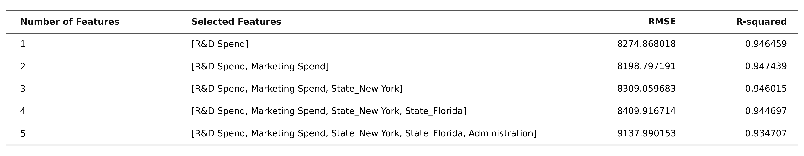
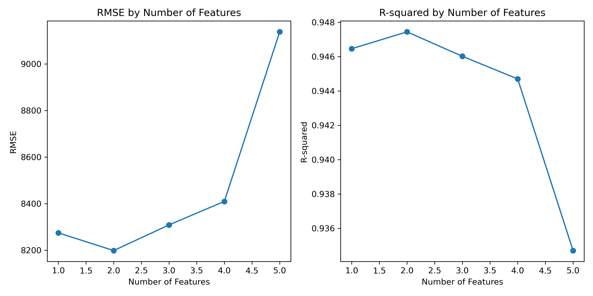

# 🚀 50 Startups 特徵工程與多元線性回歸利潤預測

[](https://chenyichencyc.github.io/1019_50startup/)
[](https://www.python.org/)
[](https://scikit-learn.org/)
[](https://opensource.org/licenses/MIT)

本專案針對經典的 **50 Startups** 資料集進行深入的特徵工程（Feature Engineering）與多元線性回歸（Multiple Linear Regression）建模。實作並比較了 **ANOVA F-test (Filter Method)**、**RFE 遞迴特徵消除 (Wrapper Method)** 以及 **Lasso 正則化 (Embedded Method)** 三種核心特徵篩選技術，評估隨特徵數量增加時模型在測試集上的泛化能力與偏差-變異權衡（Bias-Variance Tradeoff）。

---

## 🌐 線上互動展示儀表板 (Live Interactive Demo)

本專案已部署於 GitHub Pages，提供動態下拉式選單與即時計算功能：
👉 **[點此造訪 GitHub Pages 線上儀表板](https://chenyichencyc.github.io/1019_50startup/)**

### 網頁主要功能與架構：
- **首頁直接展示核心分析與預測器**：
  - 📈 **特徵數量評估與最佳化 (Sweet Spot)**：可切換互動式 Chart.js 筆直折線圖與 Matplotlib 原生 PNG 圖，附完整 1~5 特徵評估指標數據表。
  - 🧮 **即時新創利潤預測計算機**：拖動研發（R&D）與行銷（Marketing）支出滑桿，即時利用最佳回歸方程式預估獲利。
- **三大特徵篩選方法深度分析（下拉式選單專屬切換）**：
  1. 🔬 **ANOVA F-test (Filter Method 過濾法)**：各特徵 F 分數、p-value 統計顯著性長條圖與剖析
  2. 🔄 **RFE 遞迴特徵消除 (Wrapper Method 包裝法)**：特徵淘汰輪次、保留排名與標準化說明
  3. 🎯 **Lasso L1 正則化 (Embedded Method 嵌入法)**：最佳超參數 $\alpha = 1,825.83$ 下無效特徵係數收縮至 0.0 之稀疏化展示

---

## 📊 核心實驗成果 (Experimental Results)

### 1. 特徵數量逐步評估對照表

| Number of Features | Selected Features | RMSE | R-squared | 說明 |
| :---: | :--- | :---: | :---: | :--- |
| **1** | `[R&D Spend]` | `8274.868018` | `0.946459` | 單一主力特徵，已有很高的預測能力 |
| **2** | `[R&D Spend, Marketing Spend]` | **`8198.797191`** | **`0.947439`** | 🌟 **最佳模型 (Sweet Spot)**，誤差最低 |
| **3** | 加入 `State_New York` | `8309.059683` | `0.946015` | 開始受到無效特徵輕微干擾 |
| **4** | 加入 `State_Florida` | `8409.916714` | `0.944697` | 誤差持續上升 |
| **5** | 全部 5 個特徵（加入 `Administration`） | **`9137.990153`** | **`0.934707`** | ⚠️ **過擬合 (Overfitting)**，測試集表現顯著劣化 |



---

### 2. RMSE 與 R² 隨特徵數量變化趨勢



> **關鍵發現**：
> - **最佳特徵數為 2**（`R&D Spend` + `Marketing Spend`）。
> - 行政支出（`Administration`）與州別虛擬變數（`State`）均不具顯著解釋力。若盲目將所有特徵放入模型，只會擬合訓練集的隨機噪聲，使得測試集均方根誤差增加超過 **10.3%**（由 8,198 飆升至 9,138）。

---

## 🔬 三種特徵篩選方法剖析

| 類別 | 方法名稱 | 實作工具 | 排序與篩選結論 |
| :--- | :--- | :--- | :--- |
| **Filter (過濾法)** | **ANOVA F-test** | `sklearn.feature_selection.f_regression` | `R&D Spend` (F=652.39, p=1.56e-25) 與 `Marketing Spend` (F=49.08, p=2.42e-08) 達高度顯著；其餘特徵 p > 0.05 不具顯著性。 |
| **Wrapper (包裝法)** | **RFE 遞迴特徵消除** | `sklearn.feature_selection.RFE` | 透過逐步淘汰最小權重，保留順序為 `R&D Spend` (Rank 1) > `Marketing Spend` (Rank 2) > `Administration` (Rank 3) > 州別。 |
| **Embedded (嵌入法)** | **Lasso 回歸 (L1 正則化)** | `sklearn.linear_model.LassoCV` | 經 5-fold 交叉驗證選出最佳 $\alpha = 1,825.83$，成功將無效特徵（Administration 與所有州別）之係數**嚴格壓縮歸零 (0.0)**。 |

---

## 🛠️ 本地端執行與重現步驟 (Quick Start)

### 1. 複製專案庫 (Clone Repository)
```bash
git clone https://github.com/chenyichencyc/1019_50startup.git
cd 1019_50startup
```

### 2. 安裝必要套件 (Install Dependencies)
```bash
pip install -r requirements.txt
```

### 3. 執行特徵篩選與建模程式 (Run Python Script)
```bash
python main.py
```
執行後終端機將依序輸出三種方法的篩選排序、模型評估指標表格，並自動於當前目錄儲存圖檔：
- `features_performance.png`
- `features_table.png`

### 4. 本地預覽網頁儀表板
直接以瀏覽器開啟 `index.html` 即可：
```bash
open index.html   # macOS
# 或在 Windows 使用：start index.html
```

---

## 📁 專案檔案結構 (Project Structure)

```text
1019_50startup/
├── 50_Startups.csv            # 原始資料集 (R&D, Administration, Marketing, State, Profit)
├── main.py                    # 核心特徵篩選、模型訓練與圖表繪製主程式
├── requirements.txt           # Python 相依套件清單
├── index.html                 # GitHub Pages 互動式儀表板（含下拉選單與利潤預測器）
├── features_performance.png   # 特徵數量 vs RMSE / R² 折線圖
├── features_table.png         # 評估成果數據對照表格圖
└── README.md                  # 專案詳細說明文件
```

---

## 📜 最佳回歸方程式 (Optimal Regression Equation)

基於最佳雙特徵模型（$k=2$）：

$$\text{Profit} = 46,346.34 + 0.7886 \times (\text{R\&D Spend}) + 0.0326 \times (\text{Marketing Spend})$$

- 研發支出每投入 **$1.00**，預期增加約 **$0.79** 利潤。
- 行銷支出每投入 **$1.00**，預期增加約 **$0.033** 利潤。

---

## 📄 License
本專案基於 [MIT License](LICENSE) 釋出。
